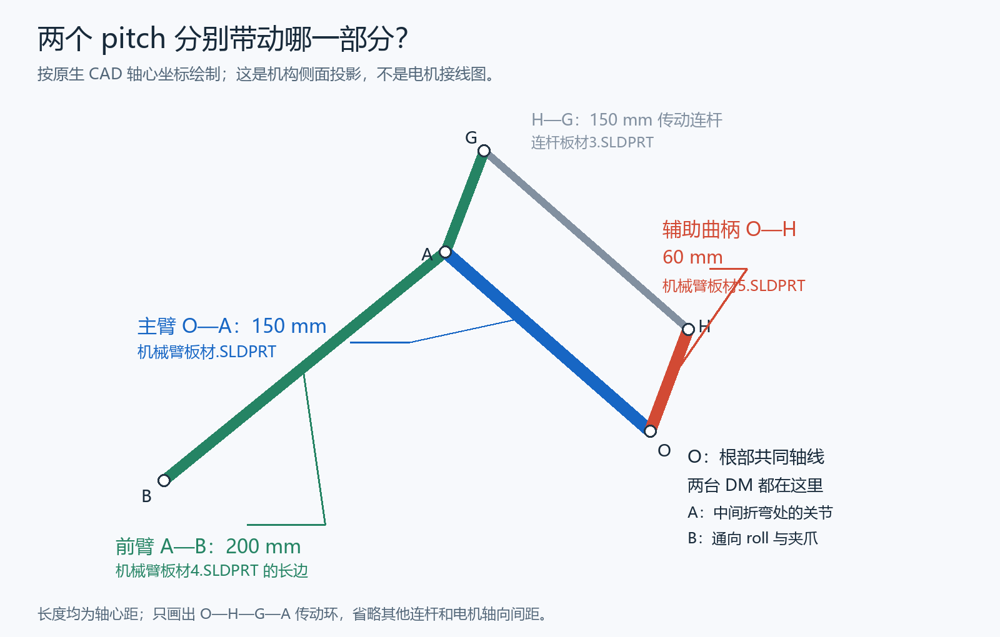

# 工程车关节控制与 CAD 传动映射

工程基于 [dx_assignment5_freertos](https://github.com/liqibei/dx_assignment5_freertos/tree/80450f4790afac2a29b0d66d94a6952ad3ab08e1)。机械臂负责人维护大/小 pitch、roll、夹爪四轴；另一位同学维护两台 M3508 底盘和大 yaw GM6020。yaw 参数独立在 `User_Driver/Arm/yaw_config.h`，运行时仍由统一 CAN1 五轴任务控制。协作入口见 [AGENTS.md](AGENTS.md)；原教学模板说明完整保存在 [docs/TEMPLATE_README.md](docs/TEMPLATE_README.md)。

整车已按《遥控器.docx》V2.1 接入 DR16 的行驶、夹取、待机模式，以及参考 `RM_task_Chassis/task_protect` 结构的关控保护。日常 `Debug/Release`（兼容入口 `BenchDebug`）提供仅两 pitch、roll、夹爪的固定四轴配置，不依赖 yaw 或底盘；整车显式使用 `VehicleDebug/VehicleRelease`。台架操作、调试变量、遥控接线和底盘 API `0x0202` 集中见 [README_REMOTE.md](README_REMOTE.md)；底盘实际差速控制仍待接入。

## 当前实现

- 6020电流模式、两台 M2006：外部位置 P + 速度 PI，输出单位为mA，按实际周期积分。
- 两台 DM4310：MIT 纯力矩指令（kp=kd=0），外部位置 P + 速度 PI，最终给电机端 Nm。位置 P、速度 PI 始终在电机驱动坐标中运行；公开肩角/肘相对角另做传动映射。
- 250 Hz（4 ms）控制任务；统一关节端角度 deg、速度 deg/s；参考轨迹限速、限加速度；手动零位标定。
- `Config.joint_mask` 选择整车五轴 `0x1f` 或台架四轴 `0x1e`；就绪、校零、使能与收发均按当前配置。台架跳过 yaw，不发送 `0x2FE`。两 pitch 始终成对校零/使能。目标超时、反馈超时、温度、驱动器故障、调度异常、CAN 异常锁存停机，通信恢复不会自动使能。
- 夹爪提供位置开合、闭合超时和动态保持电流限幅。此版没有接触检测、恒夹持力或自动撞限位寻零；超时和电流值仍需实测。
- 待机不接受新动作，进入时抓取一次反馈作为保持目标；已开控关节继续闭环和目标刷新，原本失能的轴不会自动使能。负载保持策略本轮暂不改，尚未完成承重验证。关控、遥控失联和故障使当前配置全部轴失能，恢复后须重新开控。

`工程车3.zip` 内有 82 个 SLDPRT、5 个 SLDASM。eDrawings 已显示 `四轴机械臂`；本次还对原生装配变换、尺寸标注和 Parasolid 圆柱/孔轴几何做了交叉核对，读取到下列传动与几何依据。它们不能确定实物的编码器正向、零位、允许行程或负载参数。

| CAD 读取结果 | 用于本版代码的含义 |
|---|---|
| yaw 两同步带轮均 37 齿，轴距 136 mm | 外部比例 37:37，`feedback_per_joint=1`；这是同步带传动，带路正反仍需实测 |
| 两 DM 安装座同轴；主链轴距 150 / 200 mm；辅助边 60 mm | 存在平行四边形传递关系，不能把第二台 DM 反馈直接称为肘相对角 |
| 夹爪 24T 小齿轮驱动 32T，再带动另一只 32T；轴距 28 / 32 mm | 以第一只 32T 输出轮转角定义夹爪角；M2006 转子/夹爪角比例为 `36×32/24=48` |
| 夹爪驱动臂/小连杆孔心距 85 mm，单爪两孔距 22 mm | 记录为后续开口映射依据；本版没有把角度变成开口 mm |
| roll 使用后部 M2006 与法兰联轴器 | M2006 内部 36 × 外部 1，总比例 36；外部直连仍需核对实物 |

150 / 200 / 60 mm 是几何依据，本版未新增末端逆解、重力补偿或碰撞模型。CAD 中的 150°刚性板材偏置不是软件机械零位，不会自动加入校零偏置。

图中两台 DM 都位于根部 O，分别驱动 150 mm 的长主臂 `机械臂板材-1` 和 60 mm 的短曲柄 `机械臂板材5-2`；不是把一台 DM 装在肘部。预定长板对应 ID 1、短曲柄对应 ID 2，实际接线与 ID 尚未确认。CAD 实例末尾的 `-1/-2` 不是 CAN ID。



## 接线约定与协议

已由你确认：RoboMaster C 板，STM32F407IGH6TR，DR16 接收机；五台机械臂电机共用 CAN1，CAN2 接底盘。你已同意采用下表的 ID 分配，实物尚未设置，需上板时按表配置。机械臂使用标准数据帧、8 字节、1 Mbps。

| 控制对象 | 电机 | 总线 | 电机 ID | 反馈 ID | 指令 ID | 反馈轴/驱动输出角比 |
|---|---|---|---|---|---|---|
| yaw | GM6020 电流模式 | CAN1 | 5 | 0x209 | 0x2FE 第一槽 | 1，37:37 同步带 |
| 大 pitch 驱动 | DM-J4310P-2EC-V1.1，MIT | CAN1 | 1 | 0x11 | 0x001 | 1，驱动件与实物 ID 对应待确认 |
| 小 pitch 驱动 | DM-J4310P-2EC-V1.1，MIT | CAN1 | 2 | 0x12 | 0x002 | 1，驱动件与实物 ID 对应待确认 |
| roll | M2006 + C610 | CAN1 | 1 | 0x201 | 0x200 第一槽 | 36，联轴器直连候选 |
| 夹爪 | M2006 + C610 | CAN1 | 2 | 0x202 | 0x200 第二槽 | 48，24T→32T 输出轮角 |

GM6020 已按你的选择改为电流模式。yaw 的 `max_effort`、速度PI输出和状态 `effort` 统一使用mA；发送层按 `原码=mA×16384/3000` 转换，协议 ±16384 对应 ±3A。ID1~4使用0x1FE，ID5~7使用0x2FE；当前ID5占前两个字节，反馈仍是0x209。默认调试上限为300mA（约1638原码），速度PI暂用Kp=20、Ki=5，均未经实机整定，不沿用旧电压PID。位置环与关节限速仍保持原接口。

GM6020 的 `motor_effort_feedback`/`feedback_effort` 继续保存手册定义的实际转矩电流反馈原码，不因指令量程而擅自当作mA。需在实物固件上核对其反馈比例后再用于力矩估算。电流模式要求电机固件支持并在RoboMaster Assistant中开启电流环；中文v1.4手册注明固件至少v1.0.11.2、Assistant至少v2.7。本次没有连接电机、升级固件或改变电机内部参数。

C610 命令原码 ±10000 对应 ±10A，因而其1mA/原码不能套用到6020。C610 的 DATA[6:7] 保留，此版不伪造 M2006 温度。两台 DM 的 PMAX/VMAX/TMAX 仍暂填12.5rad / 30rad/s / 10Nm，需从实物读取确认。驱动件与电机 ID 对应、零位、限位及物理遥控映射仍待实机确认，三处默认失能门槛均保留。

五台共用 CAN1 时，1 kHz 下四条控制帧加五台反馈可能超过 1 Mbps 容量。因此初版采用 250 Hz 控制，反馈仍按实际到达解析。若 DJI 三台各 1 kHz、DM 随每次命令各回一帧，合计约 4500 帧/s；若两台 DM 独立各发 1 kHz，约 6000 帧/s。按每帧约 111~135 bit（含帧间隔、取决于填充位）估算，约 50%~81% 占用，实际仍需抓 CAN 流量确认。不可直接改回 1 kHz。

DM 模式区别：MIT 同时发送目标位置、目标速度、Kp、Kd、前馈力矩；内部按这些量求力矩，再执行电流环。位置速度模式接收目标位置和最大速度，由驱动器做位置/速度/电流闭环。速度模式只接收速度，位置需要主控另外闭环。本版建议 MIT，并选择 Kp=Kd=0 的纯力矩子用法，闭环由 C 板完成。实物必须通过上位机确认 MIT 模式；代码不擅自修改电机参数或写 Flash。不同模式的帧格式和 ID 不同，不能只改模式开关；例如旧协议速度模式 `0x200+ID` 在当前 ID 分配下会与 M2006 的 0x201/0x202 反馈冲突。

M2006 编码器反馈在内部减速器前的转子侧，需除以厂家标注的 36 及外部减速比。roll 总比 `36×1=36`；夹爪总比 `36×32/24=48`，后续两只 32T 等齿数啮合只改变转向，不再增加减速比。DM 反馈按其内部减速器输出轴解释，勿重复除以内部减速比。夹爪角度指第一只 32T 驱动输出轮转角，不是 M2006 减速器输出轴角，也不是爪尖开口 mm。

主控沿用模板 STM32F407IGHx、12 MHz HSE、168 MHz SYSCLK；CAN1 PD0/PD1，CAN2 PB5/PB6，APB1 42 MHz，3×(1+7+6) 分频得到 1 Mbps。换板后要确认这些条件。

## 两 pitch 的坐标与限位

在一次联合校零所指定的同一机械姿态上，两台驱动角增量都为 0。记 `a1/a2` 为经过各自方向和比例换算后的驱动角，`q肩/q肘` 为公开关节角增量：

```text
q肩 = a1
q肘 = a2 - a1
a1目标 = q肩目标
a2目标 = q肩目标 + q肘目标
```

`BigPitch` 表示 `q肩`，`SmallPitch` 表示 `q肘`。这些都是相对联合校零姿态的增量，不是 CAD 保存姿态的绝对角。例如肩目标 10°、肘相对目标 5°，两台驱动目标为 10° / 15°。肩单独变化而肘目标不变时，第二驱动也要随肩变化。

这要求实物采用已核对的连杆分支和驱动对应。确认两 DM 正向时固定从上图所示的同一侧观察，统一约定 `a1/a2` 的同一旋转正向，例如都以该侧看逆时针为正；不能站到两台相向电机各自的外侧分别判正。

保持电机失能并支撑机构，小幅手动转动对应长主臂和短曲柄，分别观察 `g_arm_status.joint[1].drive_position_deg`、`joint[2].drive_position_deg` 的增减。约定正向运动应使对应驱动角增加；相反则在 `arm_config.cpp` 把该轴 `direction` 在 +1/-1 间改正、重新编译，再核对。第二台 DM 应观察 `drive_position_deg`，不能用已减去肩角的 `joint[2].position_deg` 当作其独立驱动角。机构不能轻松回转时不要硬掰，改用脱载、低输出、小步验证。

方向确认后，共同选一个可重复摆放的 pitch 参考姿态，两台 DM 静止时同时校零；此后 `q肩/q肘` 是相对该姿态的增量，不是 CAD 绝对角。夹爪另外采用人工定义的安全张开参考零位。

公开状态 `position_deg/velocity_deg_s/target_deg/reference_deg` 使用上述关节坐标；额外的 `drive_position_deg/drive_velocity_deg_s/drive_target_deg/drive_reference_deg/drive_reference_velocity_deg_s` 用于查看电机侧闭环。`effort`、温度、驱动状态和收帧计数仍对应物理电机；第二驱动的 `effort` 不是肘关节广义力矩。PI 不使用相减后的肘速度做第二电机速度反馈。

`arm_config.cpp` 中关节范围约束 `q肩/q肘`，`Config.pitch` 另约束第二驱动 `a2=q肩+q肘`。当前第二驱动仍暂定 −30..30°、5°/s、15°/s²，均相对联合校零姿态，尚未经实物验证。两个关节目标各自合法仍可能组合越界，例如 30°+30°。`Arm_SetTargets()` 会先检查整包与组合范围再更新，不会单独钳制第二电机而改变肘目标语义。

两 pitch 的参考沿可行关节空间线段协调推进，限制映射后的第二驱动速度与加速度；变更运动方向时先沿旧方向减速，再建立新方向。遥控层对本轮两 pitch 增量共同缩放，在组合边界处停止继续推进目标。该规划不包含整臂自碰撞、线缆或基地禁入包络。

两 DM 反馈采用各自最新收到的样本，时间差必须不超过 `Config.pitch.max_feedback_skew_ms`（当前 8 ms），且各自满足 50 ms 在线门槛；这不是硬件同步采样。任一 DM 掉线、驱动故障或时差不满足要求后，需排除原因并联合重新校零。

## 夹爪角度换算

为保持此前暂定的物理转子行程和运动包络，36→48 不只修改一个比例：

| 参数 | 旧 M2006 轴侧角定义 | 新 32T 输出轮角定义 |
|---|---:|---:|
| `feedback_per_joint` | 36 | 48 |
| 角度范围 / 闭合目标 | 0..60° | 0..45° |
| 最大速度 | 5°/s | 3.75°/s |
| 最大加速度 | 15°/s² | 11.25°/s² |
| 反馈越界锁存余量 `limit_margin_deg` | 2° | 1.5° |
| 手动校零静止阈值 `stationary_speed_deg_s` | 2°/s | 1.5°/s |
| 位置 P | 2 | 2 |
| 速度 PI Kp / Ki | 20 / 5 | 80/3 / 20/3 |
| 运动 / 保持电流上限 | 500 / 150 mA | 500 / 150 mA |

角度、速度、加速度、越界余量和校零静止阈值乘以 0.75，速度 PI 增益乘以 4/3，使同一物理位置/速度误差下的电流计算保持一致。这不是新的实机 PID 整定。开 0°、闭 45°仍是占位；夹爪零位应人工定义在安全张开参考姿态，因为当前张开目标是 0°，不能任意摆放夹爪后校零却继续使用原来的 0..45°目标。

用户已确认夹爪没有机械限位，不能撞限位寻零；roll 线缆不缠绕，但实际可用范围尚未确定。本轮保留 roll ±90°、夹爪 0..45°的暂定软件范围，不自动放开。软件范围仍需结合实物干涉、传动行程和实际负载验证，不代表 CAD 测得的机械限位。

闭合超时继续保留 2000 ms，不自动延长带电闭合时间；一次持续闭合最多推进约 7.5°输出轮目标，不能保证覆盖整个 45°暂定行程，也不能证明夹紧。完整开合行程、闭合超时、接触判断和保持电流需一起实测。

具体实现中，闭合超时后每周期将夹爪目标重置为当时反馈角并降低电流上限；这不是固定角度锁定，也不是恒力保持。右拨杆回中则在切换时截断到当时角度，随后保持该目标。夹爪控制需要结合实际物体和保持策略验证。

## 代码入口和使用

| 文件 | 用途 |
|---|---|
| `User_Driver/Arm/arm_config.cpp` | 四台机械臂电机的参数、共享保护参数，以及统一五轴配置的聚合 |
| `User_Driver/Arm/yaw_config.h` | 由底盘/yaw负责人维护 GM6020 的模式、ID、方向、限位、PID 和电流上限 |
| `User_Driver/Arm/arm_control.cpp` | 反馈解析、标定、状态机、轨迹、闭环、分组报文 |
| `Task/arm_task.h` | 供遥控器/上位机任务调用的 C 接口 |
| `Task/arm_task.cpp` | RTOS 队列、ISR 到任务的反馈交接、CAN 发送和状态快照 |
| `Task/robot_control.h` | 当前遥控版的开控、底盘互锁和共享模式接口 |
| `Task/task_protect.h/.cpp` | 默认失能、保护原因汇总及恢复后等待明确开控 |
| `User_Driver/Remote/operator_config.cpp` | 物理遥控通道和夹爪策略参数 |
| `Bsp/CAN_bsp.cpp` | 沿用模板 CAN 注册方式，修复发送快照、接收分发和错误处理 |

初次上电只收反馈并发送 DJI 零指令、DM 失能帧。`kArmConfig.hardware_confirmed=false` 会拒绝任何使能请求；遥控层 `kOperatorConfig.mapping_confirmed=false` 要求先验证物理通道；`kArmConfig.pitch.mapping_confirmed=false` 另要求确认两台 DM 对应的驱动件、符号和传动分支。三处默认保护均保留。它不会把当前姿态自动当成机械零位。

状态中的 `configuration_valid` 只说明配置数值和 ID 等结构合法，不代表上述确认门槛已通过，也不代表反馈在线、已经校零或允许使能。

把机构手动摆到约定零位并固定支撑，待电机静止后调用 `Arm_CaptureZero(mask)`。mask 只要包含任意一个 pitch，就必须同时包含两 pitch（`0x06`），否则返回 `InvalidArgument`；底层 `Arm_Enable(mask)` 同样拒绝半对 pitch。调试命令 2 自动使用当前配置的完整 mask：整车 `0x1f`、台架 `0x1e`。联合校零要确认两台驱动均静止，不能只用相减后的肘速度判断静止。夹爪须采用上述安全张开参考零位。

校零只记录 MCU RAM 偏置，不运动、不向 DM 发送保存零点指令。断电/MCU 复位后需重新标定；DJI 反馈中断超过 5 ms 也会使软件多圈位置失效并要求重新标定。跨零累计要求相邻有效反馈之间转子转角小于半圈。不能依赖上电位置当作机械绝对位置。

具体校零、清故障和遥控开控顺序统一见 [README_REMOTE.md](README_REMOTE.md)。台架健康上→中事件加回中等待请求一次开控，整车仍使用显式 `Robot_RequestControl()`；`Robot_StopControl()` 可显式关控。两种配置都不自动校零，也不在故障恢复后自动重启。

底层 `Arm_Enable(mask)` 从当前反馈姿态开始保持，不沿用使能前的目标。协调层统一调用它，并每 4 ms 刷新当前配置的目标；另一任务不应调用 `Arm_SetTargets()` 与遥控层争用目标。电机控制核心仍有 250 ms 目标看门狗；遥控和整车底盘互锁另有 100 ms 超时，台架不要求外部互锁。提交函数返回 1 只表示请求已接收，实际执行结果须读取状态；接口仅用于任务上下文。`Arm_Disable` 使用独立停机标志，不受命令队列满影响。

整车统一开五轴，台架统一开四轴，均按 `Config.joint_mask` 管理。不要在遥控任务运行时由另一任务用底层部分轴 API 绕过协调层。待机中的开控请求会被消费并忽略，须进入所选配置的运动模式、满足回中等条件后重新请求。

保护状态通过 `Robot_GetControlStatus()` 的 `protection_disabled`、`protection_current_reasons`、`protection_latched_reasons`、`protection_last_trip_ms` 查看。当前原因清除不会自动使能；故障锁存需要先排除、必要时 `Arm_ClearFaults()` 和重新校零，再回中明确开控。保护状态机只由控制任务调用，其他任务读取快照。

`Arm_SetTargets()` 可以只更新肩或肘的一个目标：另一个关节目标保持不变，组合映射通过校验后同时刷新两 pitch 的命令时间。上层不用重复手动计算第二台电机目标，也不能把第二驱动绝对角直接传给 `SmallPitch`。

`last_result` 数值：0 成功，1 参数错误，2 硬件配置未确认，3 忙，4 反馈未在线，5 未校零，6 故障未清除/驱动状态不允许，7 校零时仍运动，8 目标越界。越界或 NaN 目标会整包拒绝，不会部分更新。

`faults` 位：bit0 反馈超时、bit1 目标超时、bit2 过温、bit3 电机故障/异常失能、bit4 超软件角度保护边界、bit5 DJI 多圈位置失效、bit6 CAN/反馈队列异常、bit7 周期异常、bit8 DM 使能确认超时。当前配置任一轴故障会停全部所选轴，先排除原因、确认已失能，再 `Arm_ClearFaults()`，需要时重新校零，最后重新开控。

## 接入整车时的边界

本工程拥有其使用的整组 DJI 报文，未使用槽位填零。五轴只在 CAN1 发电机指令，故障检查和旧帧取消也仅作用于 CAN1；CAN2 底盘可以使用自己的同号 ID，互不混淆。若其他模块也要使用 CAN1 的 0x200/0x2FE，必须统一合帧/发送，不能由两个任务各自发同一 ID，否则会相互覆盖输出；同一总线上的停机取消也须统一管理。当前机械臂配置不发送6020电压帧0x1FF/0x2FF。

沿用模板原 `DJI_motor_service`，但本版本没有构造旧 `DJI_motor` 对象，其分组发送标志全为零，因此没有重复发送。旧驱动的6020类型仍是电压协议，不用于本车yaw；本版五轴均由新控制任务发送。禁止再为同一台电机额外构造旧驱动对象。控制核心保留显式 `Gm6020Voltage` 类型供旧代码兼容，当前 `arm_config.cpp` 选用 `Gm6020Current`。

CAN BSP 发送队列已改成 `can_tx_frame` 按值拷贝。修复了缓冲区复用污染历史报文、接收空槽提前解引用、CAN2 FMI 索引依赖和发送错误丢邮箱令牌的问题。队列里超过 4 ms 的旧帧丢弃；失能/故障会取消 CAN1 待发旧帧。整车仍需要电机侧通信超时保护，尤其是 DM；主控卡死/物理断线时软件无法发出停机帧。pitch 失能会失去保持力，台架验证时必须支撑负载；目前没有重力补偿、抱闸或碰撞包络。

CubeMX `.ioc` 已同步发送队列类型和USART3/DMA配置；新增任务放在 `freertos.c` 的 USER CODE 区。重新生成后要核对主 CMake、PC11、100000 baud、9B+偶校验、DMA_NORMAL，以及 USART3/DMA IRQ 定义，避免重复定义。DR16 接收/解码和操作映射已接入，但物理通道、正向及三处使能门槛待实机确认。

V2.1 行驶模式左横独立控制 yaw、右横发布底盘转向请求，`yaw_follow` 恒为 0。行驶 yaw 许可和角度/目标变化速度包络由 `RobotInterlocks.drive_yaw_*` 提供；未许可时不接受行驶 yaw 新目标，合法包络缩小但当前反馈/目标/参考越界时请求底盘停车并等待处理。该包络不是碰撞检测，也不替代机构安全行程实测。

其中 `drive_yaw_max_speed_deg_s` 仅限制遥控目标推进速率，底层参考轨迹和位置/速度闭环仍使用全局 yaw 速度上限，并非实际转速硬限制。行驶中的最终速度保护需要实测并确认是否还应下沉到底层。

共享接口版本为 `0x0202`，新增 `joint_mask`。底盘须自行检查 `updated_ms` 新鲜度，响应 `emergency_stop/stop_chassis/longitudinal_brake`，并在 `reset_chassis_motion` 或 `motion_epoch` 变化时清旧运动目标。台架 `0x1e` 始终发布底盘停止，不使用外部互锁。实际 CAN2 车轮闭环、制动、功率计 `0x31` 和 50 W 限功率均尚未接入；不能仅凭接口状态认为车已停稳或功率已受控。

## 构建与验证

需要 STM32CubeCLT（arm-none-eabi-gcc/g++）、CMake、Ninja 在 PATH：

```powershell
cmake --preset Debug
cmake --build --preset Debug
cmake --preset VehicleDebug
cmake --build --preset VehicleDebug
```

四轴日常输出到 `build/Debug/`，整车输出到 `build/VehicleDebug/`，各有 `dx_assignment5_freertos.elf`、`engineer_arm.bin`、`engineer_arm.hex`。`ARM_FOUR_AXIS_BENCH` 默认 ON；Debug/Release 和保留的 BenchDebug 明确 ON，VehicleDebug/VehicleRelease 明确 OFF。四轴固件每次上电均固定四轴，无需板载按钮；两种模式均保留三处确认门槛 false。不要混用固件与 ELF。未自动烧录或实车验证。

逻辑测试用 Python 3 + Unicorn 执行实际 ARM 指令，测试 CAN 协议和控制边界；RTOS/HAL 使用替身，测试不包含真实 CAN 总线、传感器或电机负载：

```powershell
python -m pip install --target build/test_deps -r tests/requirements.txt
python tests/run_tests.py
python tests/run_tests.py --vehicle
```

2026-11-10 本轮两种配置构建均通过；整车 42,585 条、四轴台架 42,584 条断言通过，覆盖既有传动、遥控、保护和 CAN 边界，以及四轴隔离、一次开控事件、回中/重连/故障恢复和调试命令。内存占用与现有警告见 [README.md](README.md)。测试为实际 ARM 机器码和合成输入，未烧录或硬件验证；不能证明真实方向、带载保持或实车制动效果。

## 需要你确认的参数

1. **两 DM 的实物对应。** 根部驱动 150 mm 长板 `机械臂板材-1` 的是否为 ID 1、驱动 60 mm 短曲柄 `机械臂板材5-2` 的是否为 ID 2；确认非交叉连杆分支和两轴 `direction`。没有确认前不改 `pitch.mapping_confirmed`。
2. **驱动器设置。** 两台 DM-J4310P-2EC-V1.1 的实际固件、电压版本、MIT 模式、PMAX/VMAX/TMAX、ESC_ID=1/2、MST_ID=0x11/0x12、反馈周期及通信超时；roll/夹爪 C610 ID=1/2。当前 DM 量程 12.5 rad/30 rad/s/10 Nm 是占位。
3. **零位与 pitch 组合范围。** 记录可重复摆放的联合零位姿态，实测肩、肘相对角及第二驱动 `a2=q肩+q肘` 的范围、死点和干涉；还需可用速度/加速度。CAD 保存角度不是编码器零位。
4. **roll。** 已知线缆不缠绕，实际范围仍未知；核对外部联轴器直连、方向及实物干涉，再决定是否调整暂定 ±90°、10°/s、800 mA，当前不自动放开范围。
5. **夹爪。** 已知没有机械限位；人工定义安全张开位置为 0，核对闭合正向、32T 输出轮可用角度、实际开口与角度关系。暂定 0..45°、3.75°/s、2 秒、500/150 mA 需实测；不能撞限位找零，也不能凭超时判定夹紧。
6. **低输出闭环与负载。** 核对两 pitch 0.3 Nm 上限、PID、机构回差和温升；逐步测真实负载下跟踪/下垂。用户要求负载保持策略暂不改，因此正常待机保持、关控/失联失能继续保留，不把它称为已验证承重方案。
7. **遥控和停止。** 核对四通道、左右拨杆和方向，确认关闭遥控器后有效帧停止；实测 DJI 反馈连续性、两 DM 反馈时间差与 8 ms 门槛、驱动器侧超时。台架上档关控生效后再做小角度试动。
8. **整车集成时再核对。** yaw 电流模式/带路/方向、真实停车及姿态许可、行驶/快速/yaw 包络由底盘负责人补齐；整车“下方关控”独立输入仍待明确。机械臂不能直接接触基地已确认，但当前没有基地碰撞检测能力。

## 机械臂上车刷入固件后的确认顺序

1. **选对配置，先看失能反馈。** 四轴日常用 Debug/Release（BenchDebug 保留），整车用 VehicleDebug/VehicleRelease；检查 `joint_mask`、`enabled_mask=0`、电机反馈和遥控原码。四轴台架不应出现 yaw 指令。三处确认门槛保留到实物核对完成。
2. **机械对应与人工校零。** 手扶/支撑失能机构，核对两 DM 长板/短曲柄、roll、夹爪的反馈方向和传动比；记录联合 pitch 零位及夹爪安全张开零位。更新已确认参数、重新构建后再校零。完整命令和开控步骤按 [README_REMOTE.md](README_REMOTE.md) 执行。
3. **低输出小角度。** pitch 成对验证肩变而肘目标固定时第二驱动随肩变化的关系，观察关节角与驱动角；再调 roll、夹爪。只展开当前轴的目标、反馈、effort 和已有故障状态，逐步确认跟踪、振荡、限幅和温升。
4. **待机与关控。** 核对待机保持且不自动开控、台架上档关控、遥控关闭、反馈故障，以及恢复后必须重新上→中；整车接入真实互锁后再测其失联和停车逻辑。机构保持支撑，验证电机侧超时，不用放宽超时掩盖丢帧。
5. **负载与整车留待分阶段验证。** 实测行程、组合干涉、夹爪接触和保持参数后再逐步带载；当前没有重力补偿、接触检测或恒力保持。主控卡死/总线断线时不能保证停机帧送达；底盘制动和 CAN2 停机仍由底盘模块独立完成。

## 协议依据

- [原始模板及接口](https://github.com/liqibei/dx_assignment5_freertos/tree/80450f4790afac2a29b0d66d94a6952ad3ab08e1)。
- [DJI GM6020 中文使用说明 v1.4](https://rm-static.djicdn.com/tem/17348/RoboMaster%20GM6020%E7%9B%B4%E6%B5%81%E6%97%A0%E5%88%B7%E7%94%B5%E6%9C%BA%E4%BD%BF%E7%94%A8%E8%AF%B4%E6%98%8E20231013.pdf)：电流模式分组、量程和固件要求。
- [DJI C610 使用说明](https://rm-static.djicdn.com/tem/17348/RoboMaster%20C610%20Brushless%20DC%20Motor%20Speed%20Controller%20User%20Guide.pdf)：电流量程、反馈原码、保留字节。
- [DJI M2006 参数](https://www.robomaster.com/en-US/products/components/detail/1277)：内置 36:1 减速比。
- [达妙厂家文档仓库](https://github.com/dmBots/damiao-document)及[DM-J4310 型号资料](https://github.com/dmBots/DM-J4310-2EC)：MIT 力矩模式和可配量程；实物 P 版本仍需核对。
